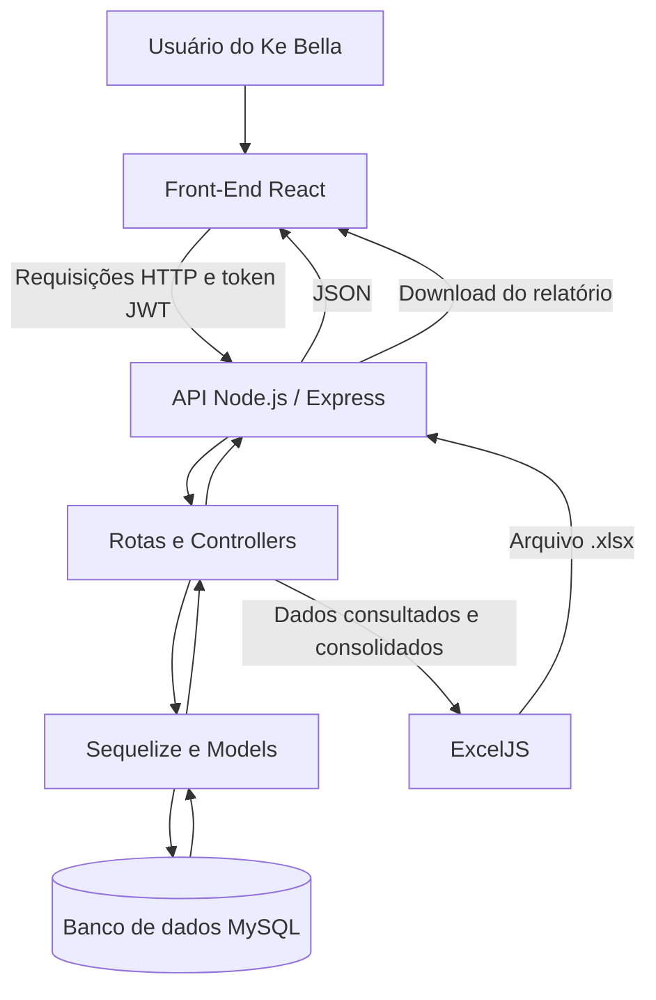
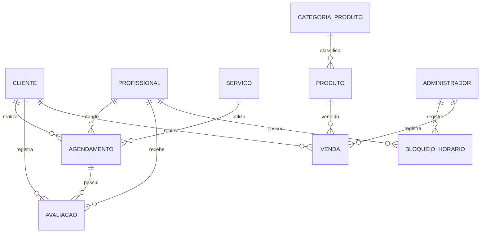
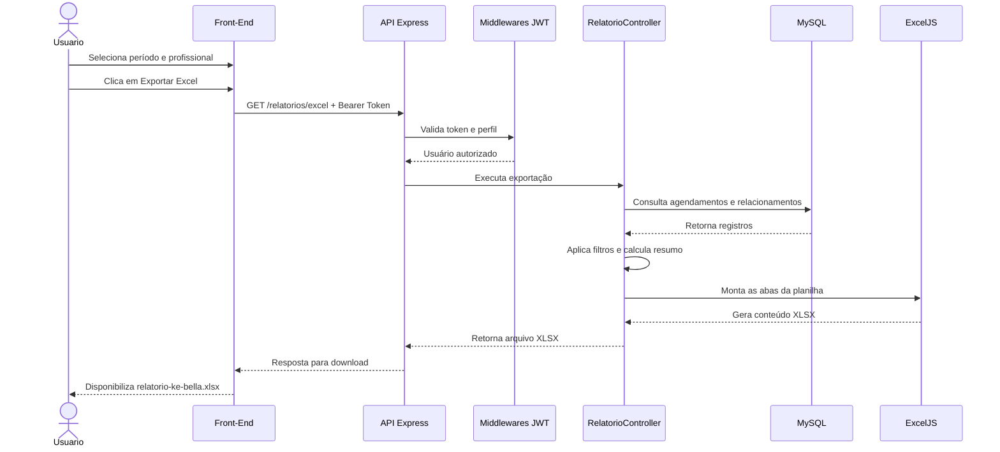

# Camada Final de Integração e Disponibilização dos Dados --- Ke Bella

**Atividade:** Projeto de Extensão --- 10/11/2026\
**Professor:** Prof. Max\
**Projeto:** Ke Bella --- Sistema Web de Gestão de Salão de Beleza

------------------------------------------------------------------------

## 1. Objetivo

Esta documentação apresenta como os dados do sistema Ke Bella são
armazenados, relacionados, disponibilizados pela API e consumidos pelas
interfaces da aplicação. Também descreve a geração de relatórios em
Excel e os controles de qualidade presentes na implementação.

A camada de integração tem como objetivo manter o fluxo de informações
entre o banco de dados MySQL, o Back-End desenvolvido em Node.js com
Express e o Front-End desenvolvido em React. Dessa forma, os dados
cadastrados e atualizados no sistema podem ser consultados pelas
funcionalidades da aplicação e utilizados na geração de indicadores e
relatórios.

## 2. Escopo da integração

A integração documentada contempla:

-   armazenamento dos dados no MySQL;
-   mapeamento das tabelas por meio dos Models do Sequelize;
-   definição dos relacionamentos entre as entidades;
-   disponibilização dos dados por rotas REST;
-   comunicação do Front-End com a API por requisições HTTP;
-   autenticação por token JWT e autorização conforme o perfil do
    usuário;
-   consulta de indicadores e geração de planilhas Excel;
-   aplicação de filtros e regras de negócio nos dados utilizados pelos
    relatórios.

A implementação analisada utiliza os próprios dados operacionais do Ke
Bella. Não foi identificada uma integração com uma API externa de dados
nem um processo ETL independente. O tratamento descrito neste documento
acontece principalmente no Back-End, durante as consultas, a aplicação
dos filtros, a consolidação dos indicadores e a geração dos relatórios.

## 3. Arquitetura da integração

A aplicação está organizada em três camadas principais:

  -----------------------------------------------------------------------
  Camada                  Tecnologia              Responsabilidade
  ----------------------- ----------------------- -----------------------
  Banco de dados          MySQL                   Persistir os dados do
                                                  sistema

  Back-End                Node.js, Express e      Acessar o banco,
                          Sequelize               aplicar regras,
                                                  autenticar usuários e
                                                  disponibilizar
                                                  endpoints

  Front-End               React, TypeScript e     Apresentar as
                          Vite                    informações e permitir
                                                  a interação dos
                                                  usuários
  -----------------------------------------------------------------------

O ExcelJS é utilizado no Back-End para montar o arquivo `.xlsx` a partir
dos dados consultados no banco. Ele é uma biblioteca instalada no
próprio projeto, e não um serviço ou uma API externa.

### 3.1. Diagrama geral



### 3.2. Organização dos componentes

**Banco de dados --- MySQL**

Armazena as informações persistentes da aplicação, como clientes,
profissionais, serviços, agendamentos, produtos, categorias, vendas,
avaliações, administradores e bloqueios de horários.

**Acesso aos dados --- Sequelize**

Os Models representam as tabelas do banco e permitem que o Back-End
consulte e manipule os registros utilizando JavaScript. O arquivo
`BackEnd/models/index.js` reúne os Models e define os relacionamentos
entre eles.

**API --- Express**

O arquivo `BackEnd/server.js` inicializa a aplicação, configura os
middlewares, registra as rotas e realiza a preparação do banco antes de
iniciar o servidor.

**Interface --- React**

A interface realiza requisições para a API, recebe os dados e apresenta
as informações em telas de gestão. A tela
`FrontEnd/src/pages/AdminDashboard.tsx` contém, entre outras
funcionalidades, a área de relatórios.

**Geração de planilhas --- ExcelJS**

O controller `BackEnd/controllers/relatorioController.js` utiliza a
biblioteca ExcelJS para gerar a planilha com os dados retornados pelas
consultas ao banco.

## 4. Origem e organização dos dados

Os dados utilizados pela aplicação têm origem nos cadastros e nas
operações realizadas no próprio Ke Bella. Eles são armazenados no MySQL
e acessados pelo Back-End.

As principais entidades mapeadas pelos Models são:

  Entidade             Finalidade
  -------------------- ------------------------------------------
  `Cliente`            Dados dos clientes
  `Profissional`       Dados dos profissionais
  `Servico`            Serviços oferecidos e seus preços
  `Agendamento`        Agendamentos, datas, horários e status
  `Administrador`      Dados de acesso administrativo
  `Produto`            Produtos cadastrados
  `CategoriaProduto`   Categorias dos produtos
  `Venda`              Registros de vendas
  `Avaliacao`          Avaliações relacionadas aos atendimentos
  `BloqueioHorario`    Horários bloqueados dos profissionais

### 4.1. Relacionamentos entre os dados

Os relacionamentos são configurados em `BackEnd/models/index.js`. Entre
os principais vínculos estão:

-   um cliente pode possuir vários agendamentos;
-   um profissional pode possuir vários agendamentos;
-   um serviço pode estar associado a vários agendamentos;
-   clientes, profissionais e agendamentos podem estar relacionados a
    avaliações;
-   uma categoria pode possuir vários produtos;
-   um profissional pode possuir vários bloqueios de horário;
-   um produto pode estar relacionado a várias vendas;
-   clientes e administradores podem estar relacionados a vendas.

### 4.2. Diagrama simplificado dos relacionamentos



O diagrama representa os relacionamentos definidos no arquivo de
configuração dos Models. A cardinalidade indica que uma entidade pode
estar relacionada a vários registros da entidade dependente.

## 5. Inicialização e integração com o banco de dados

A configuração da conexão está em `BackEnd/config/database.js`.

O projeto utiliza Sequelize para estabelecer a conexão com o MySQL e
`mysql2` para criar o banco de dados quando ele ainda não existe.

Durante a inicialização, o `BackEnd/server.js` executa a seguinte
sequência:

1.  Carrega as configurações de ambiente.
2.  Executa `garantirBancoDeDados()`, que utiliza
    `CREATE DATABASE IF NOT EXISTS`.
3.  Testa a conexão com o banco por meio de `sequelize.authenticate()`.
4.  Executa `sequelize.sync()` para sincronizar os Models com as
    tabelas.
5.  Executa `garantirAdminInicial()` para verificar a existência do
    administrador inicial e preparar os acessos profissionais previstos
    no projeto.
6.  Inicia o servidor Express.

### 5.1. Criação e sincronização

O comando `CREATE DATABASE IF NOT EXISTS` cria o banco somente quando
ele ainda não existe. Se o banco já existir, ele não é recriado.

O comando `sequelize.sync()` cria as tabelas que estiverem ausentes
conforme os Models. Na configuração atual, não foi utilizado
`alter: true` nem `force: true`. Portanto, essa chamada não tem a
finalidade de alterar automaticamente a estrutura de tabelas existentes
nem de apagá-las.

Alterações de estrutura em tabelas já existentes precisam ser avaliadas
e aplicadas de forma controlada, quando necessárias.

### 5.2. Configurações de ambiente

As credenciais e configurações de conexão devem ser mantidas em um
arquivo `.env` dentro da pasta `BackEnd`, sem publicar valores secretos
no GitHub.

As variáveis utilizadas pelo código incluem:

``` env
PORT=
DB_HOST=
DB_PORT=
DB_NAME=
DB_USER=
DB_PASSWORD=
ADMIN_NOME=
ADMIN_EMAIL=
ADMIN_SENHA=
JWT_SECRET=
JWT_EXPIRES_IN=
```

Os valores devem ser preenchidos conforme o ambiente de execução. O
arquivo `.env` não deve ser enviado ao repositório.

## 6. Disponibilização dos dados pela API

O Back-End utiliza Express para disponibilizar endpoints REST. As rotas
recebem requisições HTTP, acionam seus controllers e retornam os dados
em formato JSON ou, no caso da exportação, um arquivo Excel.

Entre os grupos de rotas registrados em `BackEnd/server.js`, estão:

  Grupo de rotas       Finalidade
  -------------------- --------------------------------------------
  `/clientes`          Cadastro e consulta de clientes
  `/profissionais`     Cadastro e consulta de profissionais
  `/servicos`          Cadastro e consulta de serviços
  `/produtos`          Cadastro e consulta de produtos
  `/agendamentos`      Operações e consultas de agendamentos
  `/auth`              Autenticação e login
  `/administradores`   Operações administrativas
  `/bloqueios`         Consulta e gerenciamento de bloqueios
  `/vendas`            Consulta e registro de vendas
  `/relatorios`        Consulta de indicadores e exportação Excel

Os endpoints possuem regras de acesso diferentes conforme a
funcionalidade. As rotas protegidas utilizam os middlewares de
autenticação e autorização.

## 7. Autenticação e controle de acesso na integração

A comunicação com os endpoints protegidos utiliza JWT (JSON Web Token).

O middleware `BackEnd/middlewares/autenticarToken.js` verifica o token
enviado no cabeçalho HTTP `Authorization`, no formato:

``` http
Authorization: Bearer TOKEN
```

Após validar o token, o middleware identifica o perfil do usuário e
consulta o respectivo registro no banco. O perfil é disponibilizado na
requisição para ser utilizado pelas regras de autorização.

O middleware `BackEnd/middlewares/autorizarPorPerfil.js` verifica se o
perfil autenticado está entre os perfis permitidos para aquela rota.

Na rota de relatórios, a configuração permite os perfis `admin` e
`profissional`.

### 7.1. Restrição dos dados por perfil

O controller de relatórios aplica uma regra específica:

-   quando o usuário autenticado é um profissional, a consulta é
    filtrada automaticamente pelo ID do próprio profissional;
-   quando o usuário é administrador, pode consultar os dados gerais ou
    informar um profissional específico pelo parâmetro `profissionalId`.

Essa regra evita que o profissional escolha livremente outro ID para
consultar os relatórios de outro profissional por meio desse endpoint.

## 8. Integração dos relatórios

A funcionalidade de relatórios conecta o banco de dados, o Back-End e a
interface administrativa/profissional.

Os principais arquivos envolvidos são:

  ----------------------------------------------------------------------------------
  Arquivo                                        Responsabilidade
  ---------------------------------------------- -----------------------------------
  `BackEnd/controllers/relatorioController.js`   Consulta, consolida os dados,
                                                 calcula os indicadores e gera a
                                                 planilha

  `BackEnd/routes/relatorioRoutes.js`            Define os endpoints e aplica
                                                 autenticação e autorização

  `FrontEnd/src/pages/AdminDashboard.tsx`        Apresenta filtros, indicadores,
                                                 tabela e botão de exportação

  `BackEnd/package.json`                         Declara a dependência `exceljs`
  ----------------------------------------------------------------------------------

### 8.1. Consulta do resumo

O endpoint abaixo retorna os agendamentos encontrados e os indicadores
calculados:

``` http
GET /relatorios/resumo
```

Parâmetros opcionais:

  -----------------------------------------------------------------------
  Parâmetro                           Descrição
  ----------------------------------- -----------------------------------
  `dataInicial`                       Data inicial do período consultado

  `dataFinal`                         Data final do período consultado

  `profissionalId`                    ID do profissional, disponível para
                                      filtro do administrador
  -----------------------------------------------------------------------

Exemplo de consulta:

``` http
GET /relatorios/resumo?dataInicial=2026-11-01&dataFinal=2026-11-30
```

O retorno contém os registros de agendamento e o objeto `resumo`, com os
indicadores:

-   `totalAgendamentos`: quantidade de agendamentos encontrados;
-   `concluidos`: quantidade de agendamentos com status `Concluído`;
-   `ticketMedio`: média do valor dos atendimentos concluídos;
-   `faturamento`: soma dos preços dos serviços dos atendimentos
    concluídos;
-   `lucroEstimado`: permanece `null`, pois o banco atual não possui
    estrutura de custos e despesas para calcular lucro.

### 8.2. Regras de cálculo

O faturamento é calculado somando o preço do serviço associado a cada
agendamento cujo status seja `Concluído`.

O ticket médio é calculado dividindo o faturamento pela quantidade de
atendimentos concluídos. Quando não há atendimentos concluídos, o ticket
médio retorna zero.

Agendamentos pendentes, confirmados, agendados ou cancelados não entram
no cálculo do faturamento. Eles continuam podendo aparecer na listagem
do período, conforme os filtros aplicados.

O sistema não apresenta lucro líquido como indicador calculado, pois não
há dados de custos e despesas cadastrados para sustentar esse cálculo.

### 8.3. Exportação para Excel

O endpoint de exportação é:

``` http
GET /relatorios/excel
```

Ele utiliza os mesmos filtros de período e profissional aplicados à
consulta do resumo.

O controller consulta os dados no banco, cria uma instância de
`ExcelJS.Workbook()` e monta duas abas:

**Aba `Agendamentos`**

Apresenta os detalhes dos agendamentos encontrados:

-   ID;
-   data;
-   horário;
-   cliente;
-   e-mail do cliente;
-   serviço;
-   profissional;
-   status;
-   valor do serviço.

**Aba `Resumo Diário`**

Agrupa os registros por data e apresenta:

-   data;
-   quantidade de agendamentos;
-   quantidade de atendimentos concluídos;
-   faturamento do dia;
-   total do período.

A soma do faturamento diário considera somente os agendamentos
concluídos.

A resposta da API utiliza o tipo de conteúdo apropriado para arquivo
Excel
(`application/vnd.openxmlformats-officedocument.spreadsheetml.sheet`) e
disponibiliza o arquivo com o nome `relatorio-ke-bella.xlsx`.

### 8.4. Fluxo de exportação



### 8.5. Consumo pelo Front-End

Na tela `AdminDashboard.tsx`, o Front-End monta os parâmetros de
consulta com `URLSearchParams`, considerando as datas selecionadas e,
para o administrador, o profissional escolhido.

A função de requisição:

1.  recupera o token com `lerToken()`;
2.  envia a requisição HTTP para a API;
3.  inclui o token no cabeçalho `Authorization`;
4.  verifica se a resposta foi bem-sucedida;
5.  interpreta respostas JSON ou conteúdo binário, conforme o tipo de
    resposta.

Para exportar, a função `exportar` solicita `/relatorios/excel`, recebe
o conteúdo como `Blob`, cria uma URL temporária para o arquivo e inicia
o download no navegador.

O resumo é consultado em `/relatorios/resumo` quando a aba `Relatórios`
é aberta ou quando os filtros são alterados.

## 9. Controles de qualidade dos dados

A implementação possui controles que ajudam a manter a consistência das
informações utilizadas pelas funcionalidades e pelos relatórios.

### 9.1. Estrutura e integridade

-   Os Models definem os tipos de dados das colunas.
-   Campos obrigatórios são definidos com `allowNull: false` quando
    aplicável.
-   Chaves primárias identificam os registros.
-   Os relacionamentos entre Models definem as associações utilizadas
    nas consultas.
-   O Sequelize centraliza o mapeamento entre objetos JavaScript e
    tabelas do MySQL.

### 9.2. Validações e regras de negócio

-   O cadastro de cliente possui validação de formato de e-mail no
    Model.
-   O e-mail do cliente é definido como único no Model.
-   O e-mail do administrador possui índice único.
-   Os relatórios aplicam filtros por data e, quando solicitado pelo
    administrador, por profissional.
-   O profissional tem seus relatórios limitados ao próprio ID.
-   O faturamento considera somente registros com status `Concluído`.
-   O ticket médio evita divisão por zero quando não existem
    atendimentos concluídos.
-   O lucro não é calculado quando não existem dados de custos e
    despesas.

### 9.3. Segurança e acesso

-   Endpoints protegidos exigem token JWT.
-   O middleware verifica o perfil do usuário.
-   As rotas de relatório permitem somente os perfis autorizados.
-   O middleware de autenticação consulta o usuário no banco e verifica
    se o registro existe e está ativo.
-   Senhas e segredos de ambiente devem permanecer fora do repositório.

### 9.4. Tratamento de erros HTTP

O servidor possui tratamento para situações como:

  Situação                                Resposta prevista
  --------------------------------------- -------------------
  Corpo da requisição com JSON inválido   HTTP 400
  Rota inexistente                        HTTP 404
  Token ausente, inválido ou expirado     HTTP 401
  Perfil sem permissão                    HTTP 403
  Erro interno não tratado                HTTP 500

Os controllers de relatório também tratam falhas de consulta e
exportação, retornando mensagens de erro ao consumidor da API.

## 10. Procedimento para executar e verificar a integração

Os testes abaixo permitem demonstrar o fluxo entre banco, API e
interface. Eles devem ser executados no ambiente local com o MySQL
disponível.

### 10.1. Preparação do ambiente

1.  Abrir o projeto no Visual Studio Code.
2.  Abrir um terminal na pasta `BackEnd`.
3.  Criar o arquivo `.env` com as variáveis de ambiente necessárias.
4.  Informar as credenciais válidas do MySQL e os dados de configuração
    do administrador.
5.  Instalar as dependências e iniciar a API.

Comandos:

``` bash
cd BackEnd
npm install
npm run dev
```

Depois, em outro terminal:

``` bash
cd FrontEnd
npm install
npm run dev
```

A API utiliza a porta definida em `PORT` ou, caso não seja informada, a
porta `3000`. O Front-End deve ser executado pelo Vite, utilizando o
endereço exibido no terminal.

### 10.2. Verificação da conexão e inicialização do banco

Ao iniciar o Back-End, verificar no terminal:

-   mensagem de criação ou existência do banco;
-   confirmação de conexão com o MySQL;
-   confirmação de sincronização das tabelas;
-   confirmação de inicialização do servidor.

A existência das tabelas também pode ser conferida pelo MySQL Workbench.

### 10.3. Teste da API

Com o servidor ativo, realizar as seguintes verificações no Insomnia ou
ferramenta equivalente:

  ----------------------------------------------------------------------------------------------------------------------
  Teste                   Requisição                                                             Resultado esperado
  ----------------------- ---------------------------------------------------------------------- -----------------------
  API ativa               `GET http://localhost:3000/`                                           Mensagem de API em
                                                                                                 funcionamento

  Login                   `POST /auth/login`                                                     Retorno de autenticação
                                                                                                 conforme as credenciais

  Resumo                  `GET /relatorios/resumo`                                               JSON com agendamentos e
                                                                                                 indicadores

  Resumo por período      `GET /relatorios/resumo?dataInicial=AAAA-MM-DD&dataFinal=AAAA-MM-DD`   Dados limitados ao
                                                                                                 período

  Resumo por profissional `GET /relatorios/resumo?profissionalId=ID`                             Dados do profissional
                                                                                                 selecionado, para
                                                                                                 administrador

  Exportação              `GET /relatorios/excel`                                                Download ou resposta
                                                                                                 binária do arquivo XLSX
  ----------------------------------------------------------------------------------------------------------------------

Para as rotas de relatório, incluir o token válido no cabeçalho:

``` http
Authorization: Bearer TOKEN
```

### 10.4. Teste pela interface

1.  Iniciar o Back-End e o Front-End.
2.  Entrar no sistema com um usuário administrador.
3.  Acessar o painel administrativo.
4.  Abrir a aba `Relatórios`.
5.  Selecionar uma data inicial e uma data final.
6.  Se necessário, selecionar um profissional.
7.  Conferir os indicadores e a listagem de atendimentos.
8.  Clicar em `Exportar Excel (.xlsx)`.
9.  Abrir o arquivo baixado e conferir as abas `Agendamentos` e
    `Resumo Diário`.

Também é possível repetir a verificação com um usuário profissional para
confirmar que os dados exibidos e exportados ficam restritos ao próprio
profissional.

## 11. Evidências de funcionamento

As evidências devem ser registradas a partir da execução real do
projeto. Recomenda-se incluir no repositório capturas de tela que
demonstrem:

  -----------------------------------------------------------------------
  Evidência                           O que deve mostrar
  ----------------------------------- -----------------------------------
  01 --- Inicialização do Back-End    Conexão com MySQL, sincronização e
                                      servidor iniciado

  02 --- Banco de dados               Banco e tabelas visualizados no
                                      MySQL Workbench

  03 --- API de resumo                Resposta JSON do endpoint
                                      `/relatorios/resumo`

  04 --- Relatórios na interface      Filtros, indicadores e listagem na
                                      aba `Relatórios`

  05 --- Exportação Excel             Arquivo `.xlsx` baixado e aberto

  06 --- Conteúdo da planilha         Abas `Agendamentos` e
                                      `Resumo Diário`

  07 --- Controle por perfil          Consulta realizada com perfil
                                      profissional, demonstrando a
                                      restrição dos próprios dados
  -----------------------------------------------------------------------

As imagens devem ser adicionadas somente depois de os testes serem
executados. Não se deve apresentar uma captura ilustrativa como se fosse
uma evidência de execução real.

Sugestão de organização:

``` text
Documentacao/
└── integracao_dados/
    ├── CAMADA_FINAL_INTEGRACAO_DADOS.md
    └── evidencias/
        ├── 01-inicializacao-backend.png
        ├── 02-banco-mysql.png
        ├── 03-api-resumo.png
        ├── 04-tela-relatorios.png
        ├── 05-exportacao-excel.png
        ├── 06-planilha-gerada.png
        └── 07-acesso-profissional.png
```

## 12. Limitações identificadas

A documentação considera a implementação presente no código analisado.
Algumas limitações devem ser consideradas na interpretação dos
resultados:

-   A integração utiliza os dados internos do banco MySQL; não foi
    identificado consumo de fonte externa de dados nesta camada.
-   A geração do Excel é realizada localmente pelo Back-End com a
    biblioteca ExcelJS.
-   O faturamento considera o preço atual do serviço associado ao
    agendamento. O código não demonstra um registro histórico do preço
    praticado no momento em que cada agendamento foi criado.
-   O lucro não é calculado porque não há dados de custos e despesas
    suficientes no banco.
-   O código aplica os filtros de data recebidos na consulta, mas não
    apresenta, nesse controller, validação específica para todos os
    formatos ou para a coerência entre data inicial e data final.
-   A sincronização atual cria tabelas ausentes, mas não substitui um
    processo controlado de migração para alterações estruturais em
    tabelas já existentes.

Esses pontos não impedem a demonstração do fluxo de integração
implementado, mas delimitam o que os relatórios podem afirmar com
segurança.

## 13. Resultado da atividade

A camada final de integração do Ke Bella conecta o armazenamento no
MySQL, o acesso aos dados por meio do Sequelize, a disponibilização das
informações pela API Express e o consumo pelo Front-End React.

Além das consultas utilizadas pelas telas do sistema, foi implementada
uma funcionalidade de relatórios que reúne dados de agendamentos, aplica
filtros, calcula indicadores e disponibiliza uma planilha Excel para
download. O acesso aos relatórios é protegido por autenticação JWT e
autorização por perfil, com restrição automática dos dados consultados
por profissionais.

Dessa forma, a aplicação apresenta um fluxo de dados integrado desde sua
origem no banco até o consumo pelas interfaces e pela exportação de
relatórios, acompanhado de regras de negócio e controles de qualidade
descritos nesta documentação.

------------------------------------------------------------------------

**Documento referente à atividade do Projeto de Extensão de 10/11/2026
--- Camada Final de Integração e Disponibilização dos Dados.**
